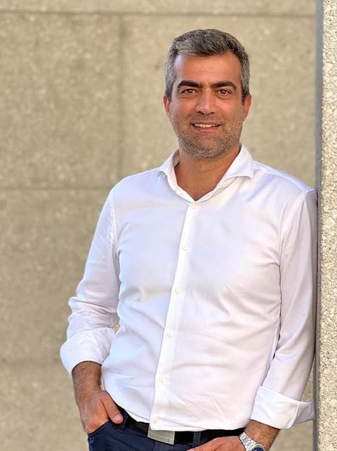

<figure class="portrait"></figure>

## Dr. Arash Kermani Kolankeh

Dr. Arash Kermani Kolankeh promovierte in Informatik an der TU Chemnitz. Frühere Stationen waren das Educational-Technology-Labor des Deutschen Forschungszentrums für Künstliche Intelligenz (DFKI), die Lufthansa und die deutsche Automobilindustrie. Dr. Kermani Kolankeh lehrt Mathematik und Künstliche Intelligenz an der Canadian University Dubai, ist Gründer von Khayyammath.com und kamangir.school und veröffentlicht seit mehr als zehn Jahren kostenlose interaktive Vorlesungen.

Links: <a href="https://kermany.de">kermany.de</a> · <a href="https://www.linkedin.com/in/dr-arash-kermani-kolankeh-69b23296/">LinkedIn</a>

## Rolle bei Sanad

- Kommissarischer Verantwortlicher für die Spezifikation. Hält Namen, Domains und Repositories treuhänderisch.
- Die Governance liegt derzeit bei einer Person. Eine zweite verantwortliche Person wird gewonnen. Die Grenzen der Befugnisse einer einzelnen Person regelt die <a href="/governance/" hreflang="en">Governance-Charta</a> (englisch).
- Offenlegung von Interessen: Der Verantwortliche betreibt auch das Kamangir-Projekt, das den Referenzcode geschrieben hat und die Erklärseite hostet. Das Kamangir-Projekt hat in der Spezifikation, in den Vektoren und bei der Wahl der Bestätigenden keine Sonderstellung.

Kontakt: siehe [Kontakt](/de/kontakt/).
