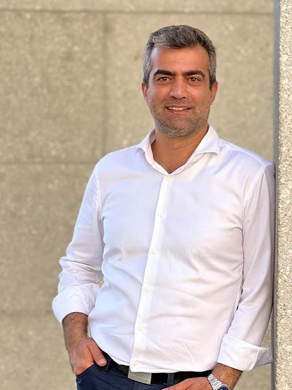

<figure class="portrait"></figure>

## Dr. Arash Kermani Kolankeh

Dr. Arash Kermani Kolankeh holds a PhD in computer science from TU Chemnitz, Germany. Earlier positions were at the educational-technology lab of the German Research Center for Artificial Intelligence (DFKI), at Lufthansa and in the German automobile industry. Dr. Kermani Kolankeh teaches mathematics and artificial-intelligence courses at the Canadian University Dubai, is the founder of Khayyammath.com and of kamangir.school, and has published free interactive lectures for more than ten years.

Links: [kermany.de](https://kermany.de) · [LinkedIn](https://www.linkedin.com/in/dr-arash-kermani-kolankeh-69b23296/)

## Role in Sanad

- Interim steward of the specification. Holds the name, the domains and the repositories in trust.
- Governance is currently one-person. A second steward is being appointed. The limits on what one steward may do are set out in the [governance charter](/governance/).
- Declaration of interests: the steward also runs the Kamangir project, which wrote the reference code and hosts the explainer. The Kamangir project has no privileged status in the specification, the vectors or the choice of attestors.

Contact: see [Contact](/contact/).
